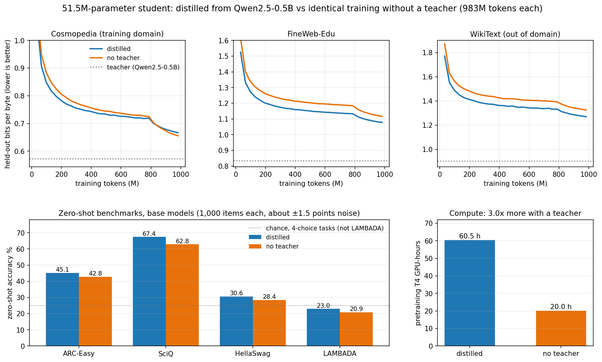

# TinyLM: a 51.5M-parameter language model distilled from Qwen2.5-0.5B

A small decoder-only language model trained from scratch by knowledge distillation from [Qwen2.5-0.5B](https://huggingface.co/Qwen/Qwen2.5-0.5B), plus a **control run** with identical settings and no teacher, to measure what the teacher actually buys. Everything was trained on 2x Tesla T4 GPUs (Kaggle's free tier): 66 GPU-hours for the distilled model, 22 for the control.

| | Weights | Chat with it |
|---|---|---|
| Distilled from Qwen2.5-0.5B | [adyaanahmed/Distil_50M_SLM](https://huggingface.co/adyaanahmed/Distil_50M_SLM) | `python chat.py` |
| Control: same recipe, no teacher | [adyaanahmed/distil-50m-no-teacher](https://huggingface.co/adyaanahmed/distil-50m-no-teacher) | `hf download adyaanahmed/distil-50m-no-teacher --local-dir weights-no-teacher`, then `python chat.py --dir weights-no-teacher` |



> **Earlier version.** This repository used to hold a different project, a 1-10M-parameter GPT trained on TinyStories with scaling, LoRA and KV-cache experiments. It is preserved under the tag [`v1-tinystories-experiments`](https://github.com/Adyaanismyname/TinyLM/tree/v1-tinystories-experiments).

## Results

Both models: 51,532,544 parameters, 983M training tokens (19 per parameter), same data in the same order, same seed, optimiser and schedule. The only difference is the loss.

Held-out bits per byte (lower is better; comparable across tokenizers):

| Set | Distilled | No teacher | Teacher (Qwen2.5-0.5B) |
|---|---|---|---|
| Cosmopedia (training domain) | 0.666 | **0.655** | 0.572 |
| FineWeb-Edu | **1.078** | 1.117 | 0.835 |
| WikiText (out of domain) | **1.270** | 1.325 | 0.905 |

Zero-shot benchmarks, base models, 1,000 items each (about ±1.5 points of noise):

| | Distilled | No teacher |
|---|---|---|
| ARC-Easy (acc_norm) | **45.1** | 42.8 |
| SciQ (acc) | **67.4** | 62.8 |
| HellaSwag (acc_norm) | **30.6** | 28.4 |
| LAMBADA (acc) | **23.0** | 20.9 |
| Pretraining cost, T4 GPU-hours | 60.5 | **20.0** |

What this shows:

- The teacher helps most on text the model was not trained on, and the distilled model is ahead on all four benchmarks. Only the SciQ gap clearly exceeds the evaluation noise.
- On the training domain it is a near tie: the distilled model led for most of training and the no-teacher model passed it during the final learning-rate decay.
- The price is about 3x the compute per token, because every step also runs the teacher.
- One run per arm: there is no seed-to-seed variance estimate, so read the smaller gaps as indicative.

The instruction-tuned versions and full numbers are in [`results/`](results/) (`report_*.json`, training curves).

## The model

| | |
|---|---|
| Architecture | 18 layers, d_model 512, grouped-query attention (8 query / 2 KV heads, head dim 64) with per-head QK-norm, SwiGLU (hidden 1280), RoPE, RMSNorm, 512-token context |
| Embeddings | 32,768-token vocabulary (the 32,767 most useful Qwen2.5 tokens + UNK), factorised and tied: 32,768 x 128 projected to 512 |
| Size | 51.5M parameters (47.2M in the blocks), 99 MB in fp16, about 0.1 GFLOPs per token, 9 KB of KV cache per token |
| Distillation loss | 0.7 x KL(teacher ‖ student) + 0.3 x cross-entropy, computed over the student's vocabulary subset |
| Optimiser | Muon for the 2-D block weights, AdamW for the rest; lr 1.5e-3, warmup-stable-decay schedule; fp16 with loss scaling |
| Data | ~1.02B tokens: Cosmopedia v2 (64%) and FineWeb-Edu with educational score >= 3 (36%) |
| Instruction tuning | 150k smol-smoltalk first exchanges (about 130k kept), distilled from Qwen2.5-0.5B-Instruct (control: plain cross-entropy) |
| Training setup | 15,000 steps x 65,536 tokens, 2-GPU DDP, resumable checkpoints across 12-hour Kaggle sessions |

## Try it

```bash
pip install -r requirements.txt
hf download adyaanahmed/Distil_50M_SLM --local-dir weights
python chat.py                       # instruction-tuned model (single-turn)
python chat.py --model pretrained    # raw text continuation
```

(`huggingface-cli download` works too.) Inside the chat: `/temp 0.4`, `/topk 40`, `/rep 1.15`, `/len 200`. Runs on CPU at roughly 20-30 tokens per second (there is no KV cache in the sampling loop). The first run downloads the Qwen2.5 tokenizer.

This is a 51M-parameter model. It writes fluent, well-formatted text but **invents facts and cannot do arithmetic**; do not rely on it for anything that matters.

## Reproduce the training

The notebooks are self-contained: they write the code in [`hybrid50m/`](hybrid50m/) to disk and drive it. They are meant for Kaggle (GPU T4 x2, internet on).

1. Upload [`notebooks/distill_distilled.ipynb`](notebooks/distill_distilled.ipynb) to Kaggle. Set `RUN_MODE = "data"` in the config cell, then *Save Version, Save & Run All*. This downloads and tokenises the corpora and writes the training data. Save its output as a Kaggle dataset.
2. Create a new session with that dataset attached and `RUN_MODE = "pretrain"`. Pretraining resumes from its checkpoint and stops cleanly before Kaggle's 12-hour limit; for later sessions attach the previous session's output (as a dataset) as well and run again. About 30 hours in total across several sessions. When pretraining is done the same notebook continues into instruction tuning and exports the models, a report and training curves.
3. For the control run use [`notebooks/distill_no_teacher.ipynb`](notebooks/distill_no_teacher.ipynb) (about 10 hours, one session). It is identical except `KD = False` and `SFT_ALPHA = 0`. **Do not attach the distilled run's checkpoints to it**; the notebook restores any checkpoint it finds in its inputs.

`RUN_MODE = "smoke"` (the default) runs a few-minute end-to-end check on tiny data, and `"pilot"` compares training setups for equal wall-clock time.

## Repository layout

```
hybrid50m/        model.py   the student (GQA, QK-norm, SwiGLU, RoPE, factorised tied embedding)
                  optim.py   Muon + AdamW
                  core.py    vocabulary map, teacher wrapper, KD loss, evaluation, benchmarks, checkpoints, export
                  data.py    corpus download, tokenisation, vocabulary selection, SFT data
                  train.py   pretraining / pilot / SFT stages (single process or torchrun DDP)
                  selftest.py  unit checks (causality, optimiser parity, schedule, sampler resume, bits-per-byte)
notebooks/        the two Kaggle notebooks (distilled run, no-teacher control)
results/          reports, training curves and the comparison figure
chat.py           local chat with the exported weights
```

Run the self-tests with `cd hybrid50m && python selftest.py`.

## Limitations

- Single-turn, 512-token context, English only; no safety tuning.
- Long answers can drift or loop; a repetition penalty of about 1.15 and temperature 0.4-0.6 help.
- Benchmark differences below about 1.5 points are within noise at 1,000 items.
- One training run per configuration.

## Acknowledgements and licence

Code: Apache-2.0 (see [LICENSE](LICENSE)). The weights are Apache-2.0 too. The teachers are Qwen2.5-0.5B and Qwen2.5-0.5B-Instruct (Apache-2.0); the data are Cosmopedia v2 and smol-smoltalk (Apache-2.0) and FineWeb-Edu (ODC-By 1.0). The architecture follows the deep-and-narrow recipe of MobileLLM, and the optimiser is Muon. Thanks to the Qwen team and Hugging Face for the models and datasets.
